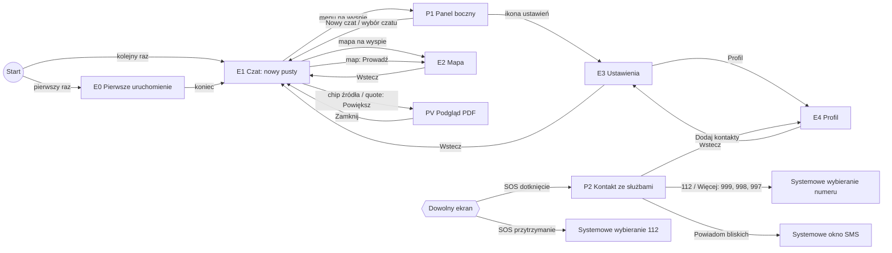

# Ekrany i panele

Specyfikacja warstwy UI dla buildera. **Wygląd (kolory, typografia, komponenty): [design system](../08-design-system/README.md); które komponenty składają każdy ekran: [mapa komponentów](../08-design-system/komponenty.md).** Każdy plik opisuje jeden ekran albo panel według [wzoru specyfikacji](#wzór-specyfikacji-ekranu). Zachowanie funkcji (co robi, skąd dane) opisują pliki w [02-funkcje](../02-funkcje/). Gdy ekran i funkcja się różnią, obowiązuje nowsza decyzja z listy [Decyzje w tym folderze](#decyzje-w-tym-folderze). Oznaczenia P0/P1 w plikach ekranów to waga w produkcie; **co budujemy w MVP, rozstrzyga [zakres MVP](../07-hackathon/zakres-mvp.md)**.

## Decyzje w tym folderze

Decyzje właściciela produktu z 2026-11-21. Zastępują dawny układ z pięcioma zakładkami na dolnym pasku.

1. Nie ma dolnego paska zakładek. Czat jest ekranem głównym.
2. Lewy górny róg czatu: pływająca „wyspa” z dwoma przyciskami: menu (otwiera panel boczny) i mapa (otwiera ekran Mapa).
3. Prawy górny róg: pływający przycisk SOS na każdym ekranie. Dotknięcie otwiera Panel 2 „Kontakt ze służbami”. Przytrzymanie od razu wybiera 112 (z potwierdzeniem systemu).
4. Na ekranach innych niż czat lewy górny róg zajmuje pływający przycisk Wstecz zamiast wyspy.
5. Wiele czatów. Panel boczny: „Nowy czat”, lista czatów od najnowszego, tytuł z pierwszej wiadomości (bez AI), przytrzymanie usuwa czat, ikona ustawień na dole.
6. Start aplikacji otwiera nowy pusty czat. Pusty czat nie jest zapisywany, dopóki użytkownik nie wyśle pierwszej wiadomości.
7. Odpowiedzi asystenta składają się z [szablonów](szablony-czatu.md): `steps`, `bullets`, `map`, `animation`, `call`, `signal`, `quote`, `cpr`.
8. Karty ratunkowe nie są osobnymi ekranami. To wiadomość w czacie złożona z szablonów, wstawiana od razu po wykryciu frazy albo po szybkim przycisku, bez modelu AI.
9. Instruktor RKO działa w czacie jako szablon `cpr`. Gdy działa, jest przypięty nad polem wiadomości.
10. Plan 72 h i plecak ewakuacyjny to odpowiedzi w czacie (`steps`, `bullets` ze źródłami), budowane z profilu. Nie ma ekranów „Mój plan” ani „Poradniki”. Biblioteka PDF odpada.
11. Źródło otwiera się w czacie (szablon `quote`) albo w pełnoekranowym podglądzie PDF z podświetlonym fragmentem.
12. Profil jest tylko lokalny, bez kont. Powstaje przy pierwszym uruchomieniu, edycja w Ustawienia → Profil. Jest kontekstem dla AI.
13. „Powiadom bliskich” przygotowuje SMS do kontaktów ICE w systemowym oknie wiadomości. Aplikacja nigdy nie wysyła SMS sama. 112 nie jest wpisywane jako odbiorca SMS.

## Spis ekranów i paneli

| Id | Nazwa | Plik | Jak się tam dostać |
|---|---|---|---|
| E0 | Pierwsze uruchomienie | [ekran-0-pierwsze-uruchomienie.md](ekran-0-pierwsze-uruchomienie.md) | Automatycznie przy pierwszym starcie aplikacji |
| E1 | Czat | [ekran-1-czat.md](ekran-1-czat.md) | Każdy kolejny start (nowy pusty czat), koniec E0, wybór czatu lub „Nowy czat” w P1, Wstecz z E2/E3 |
| E2 | Mapa | [ekran-2-mapa.md](ekran-2-mapa.md) | Ikona mapy na wyspie, „Prowadź” lub dotknięcie mini mapy w szablonie `map` |
| E3 | Ustawienia | [ekran-3-ustawienia.md](ekran-3-ustawienia.md) | Ikona ustawień na dole P1 |
| E4 | Profil | [ekran-4-profil.md](ekran-4-profil.md) | E3 → „Profil”, link „Dodaj kontakty” w P2 |
| P1 | Panel boczny | [panel-1-boczny.md](panel-1-boczny.md) | Przycisk menu na wyspie w E1, przesunięcie od lewej krawędzi w E1 |
| P2 | Kontakt ze służbami | [panel-2-kontakt-ze-sluzbami.md](panel-2-kontakt-ze-sluzbami.md) | Dotknięcie SOS na dowolnym ekranie |
| — | Szablony w czacie | [szablony-czatu.md](szablony-czatu.md) | Elementy odpowiedzi w E1 |
| PV | Podgląd PDF (pełny ekran) | [szablony-czatu.md](szablony-czatu.md#podgląd-pdf-pełny-ekran) | Przypis / wiersz listy „Źródła · n”, „Powiększ” w szablonie `quote` |

## Mapa nawigacji

Zasady:

- Stos nawigacji: E1 jest zawsze na dnie. E2, E3, PV wchodzą na E1. E4 wchodzi na E3 (albo na ekran, z którego otwarto P2).
- Systemowy przycisk Wstecz (Android): najpierw zamyka otwarty panel lub dialog, potem cofa ekran. Na E1 bez otwartych paneli przenosi aplikację w tło.
- Szablon `call` w czacie wywołuje te same akcje co P2 (ten sam komponent).

## Elementy globalne

Renderowane w korzeniu aplikacji, nad nawigatorem (`RootOverlay`), a nie w każdym ekranie osobno. Wszystkie leżą w bezpiecznym obszarze (pod paskiem statusu systemu).

| Element | Komponent | Gdzie | Zachowanie |
|---|---|---|---|
| Wyspa | `NavIsland` | E1, lewy górny róg | Kapsuła z dwoma przyciskami po min. 48 × 48 dp: `≡` otwiera P1, `▦` (mapa) otwiera E2. Etykiety dla czytnika: „Menu”, „Mapa”. |
| Wstecz | `BackButton` | E2, E3, E4, lewy górny róg | Okrągły przycisk 48 × 48 dp, strzałka „←”. Cofa jeden ekran. Etykieta: „Wróć”. W PV zamiast strzałki „✕” z etykietą „Zamknij”. |
| SOS | `SosButton` | Każdy ekran (E1–E4, PV) i nad każdym panelem, prawy górny róg | Czerwony, min. 56 × 56 dp, napis „SOS”. Dotknięcie: otwiera P2 (gdy P2 jest otwarty: nic). Przytrzymanie 800 ms: wibracja i `tel:112` (system pokazuje potwierdzenie). Podczas przytrzymania wypełnia się obwódka. Etykieta: „SOS, kontakt ze służbami. Przytrzymaj, aby zadzwonić pod 112.” W E0 też widoczny. |
| Wskaźnik RKO | `CprIndicator` | E2, E3, E4, PV, gdy działa instruktor RKO | Środek u góry: `● RKO 03:42 · wróć`. Dotknięcie wraca do E1. *Domyślne, do potwierdzenia.* |

### Stan GPS i baterii

Nie ma globalnego wskaźnika stanu (wskaźnik `offline · GPS · bateria` usunięty, decyzja 2026-11-21). Stan GPS i baterii jest tam, gdzie ma znaczenie: na mapie (`Notice` w pasku: brak GPS, niska bateria), w `MapCard` (szablon `map`) i w `CallPanel` (linia GPS). Aplikacja działa tak samo online i offline, więc stanu sieci nie pokazujemy.

### Kolejność warstw (od góry)

1. Okna systemowe (wybieranie numeru, okno SMS, uprawnienia). Poza kontrolą aplikacji.
2. **SOS.** Zawsze najwyżej spośród warstw aplikacji. Nic, co rysuje aplikacja, go nie zasłania.
3. Stroboskop ekranu z szablonu `signal`.
4. Dialogi i komunikaty aplikacji (potwierdzenia, toasty).
5. P2 Kontakt ze służbami.
6. PV Podgląd PDF.
7. P1 Panel boczny z przyciemnieniem tła.
8. Wyspa, Wstecz, wskaźnik RKO.
9. Przypięty instruktor `cpr` i pole wiadomości.
10. Treść ekranu.

Reguły wykonania:

- Elementy globalne (`SosButton`, wyspa) renderować w `RootOverlay`: `Stack` w `MaterialApp.builder`, nad `Navigator`. Dialogi, arkusze i toasty otwierać przez `Navigator` aplikacji (`showDialog`, `showModalBottomSheet` bez `useRootNavigator` ponad `RootOverlay`), żeby zawsze leżały pod SOS.
- Toasty pokazywać na dole, nad polem wiadomości. Nigdy w prawym górnym rogu.
- Klawiatura nie przesuwa SOS ani wyspy.
- W MVP jest tylko motyw ciemny. Po MVP w motywie kryzysowym elementy globalne nie mają animacji (poza obwódką przytrzymania SOS).

## Wzór specyfikacji ekranu

Każdy plik ekranu lub panelu ma te sekcje, w tej kolejności:

| Sekcja | Zawartość |
|---|---|
| Cel | Jedno, dwa zdania: po co jest ekran |
| Wejście / wyjście | Skąd się tu trafia i dokąd można przejść |
| Układ | Szkic ASCII o szerokości ok. 32 znaków. Legenda pod szkicem, gdy symbole nie są oczywiste |
| Elementy | Tabela: element · zachowanie |
| Stany | Pusty, ładowanie / AI generuje, tryb bez AI, offline, brak GPS, niska bateria, błędy. Stan, który nie dotyczy ekranu, oznaczony „nie dotyczy” |
| Teksty | Dokładne polskie teksty interfejsu. Builder kopiuje je bez zmian |
| Kryteria akceptacji | Lista `- [ ]` do sprawdzenia ręcznie lub testem |
| Powiązane funkcje | Linki względne do plików w `02-funkcje` |

Legenda symboli w szkicach: `[≡ ▦]` wyspa (menu, mapa), `(SOS)` lub `[SOS]` przycisk SOS, `(←)` lub `[<]` Wstecz, `(➤)` wyślij, `[ ]` / `[✓]` krok niezrobiony / zrobiony, `▸ …` chip źródła.

## Do potwierdzenia

Wartości domyślne przyjęte bez decyzji właściciela. Builder je wdraża; zmiana nie wymaga przebudowy.

- Szybkie przyciski pustego czatu: „Ktoś nie oddycha”, „Brak prądu”, „Alarm / schron”, „Ewakuacja” (przejęte z dawnej specyfikacji).
- W P2 kolejność: 112 na pierwszym miejscu, „Powiadom bliskich” niżej; reszta (999, 998, 997, współrzędne, adres, notki) pod zwiniętym „Więcej”. Właściciel wymienił tę funkcję jako pierwszą; 112 wyżej wynika z zasady projektowania pod stres (jedna, najważniejsza akcja najwyżej).
- Napis na przycisku: „SOS” (dawna specyfikacja: „SOS 112”). Przytrzymanie: 800 ms.
- Tekst SMS bez polskich znaków (mieści się w mniejszej liczbie części SMS). Link do mapy w SMS: OpenStreetMap (`https://www.openstreetmap.org/?mlat={lat}&mlon={lon}#map=17/{lat}/{lon}`), bez Google. Do potwierdzenia: czy link otwiera się czytelnie w domyślnej przeglądarce odbiorcy.
- Przełącznik „Dołącz dane z profilu” w P2: domyślnie włączony (do potwierdzenia). Wyłączony = SMS bez linii `{profil}`.
- Jeden systemowy SMS do wszystkich kontaktów ICE naraz. Do sprawdzenia na urządzeniu: Android może zamienić wiadomość grupową na MMS, który wymaga danych komórkowych. Jeśli tak, wysyłać osobny SMS do każdego kontaktu.
- Tytuł czatu: pierwsza wiadomość przycięta do 40 znaków na granicy słowa.
- Limit czasu odpowiedzi AI: 20 s bez pierwszego panelu → odpowiedź jak w trybie bez AI.
- Próg niskiej baterii: `settings.lowBatteryPct`, domyślnie 20%, do wyboru 15/20/30% (automatyczny tryb bez AI, jeśli tak ustawiono w E3). Nigdzie nie wpisujemy progu na sztywno; teksty używają `{n}`.
- Instruktor RKO jest jeden na całą aplikację, działa dalej po wyjściu z czatu (wskaźnik RKO). Metronom i głos grają w tle, np. podczas rozmowy z 112 na głośniku (decyzja z 2026-11-21; etap po MVP).
- Szablon `animation` przy ograniczeniu ruchu (po MVP także w motywie kryzysowym) nie startuje sam (pierwsza klatka + „Odtwórz”).
- E0: zgoda na lokalizację przed pobieraniem paczek (żeby od razu wykryć województwo).
- E3: w MVP tylko motyw Ciemny (Systemowy, Jasny i Kryzysowy po MVP; po MVP domyślny „Systemowy”); „Usuń wszystkie dane” nie kasuje paczek (bez sieci nie da się ich odzyskać).
