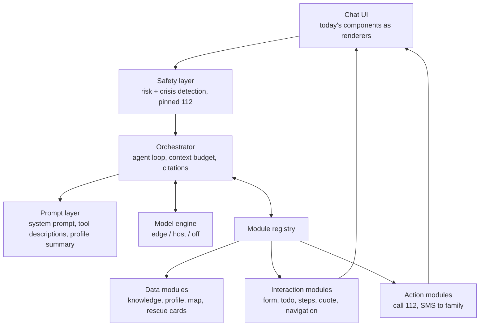

# Architecture overview

Five layers. Each can be swapped or tested without the others.

| Layer | Owns | Does not own |
|---|---|---|
| Safety | Phrase detection on the user's text, pinning 112, crisis line | Answer content |
| Orchestrator | The turn: retrieval, model calls, tool dispatch, token budget, mapping citations to sources | Prompt wording, module logic |
| Prompt layer | System prompt text, rendering tool descriptions, short profile summary | Which tools exist (asks the registry) |
| Engine | Loading the model, one live conversation, streaming, cancel | Anything domain-specific |
| Registry + modules | What the app can do; each module is self-contained | When to call it (the model or the orchestrator decides) |

## One turn

1. **Safety:** the user's sentence is checked for risk or crisis. On a hit, 112 is pinned at once. The turn continues, the model still answers, and a crisis adds the caring instruction and the 116 123 line.
2. **Retrieval** (app-side, not the model's choice): for any content sentence, hybrid search over the guides, using the sentence plus the previous user turn. 2–3 compact snippets are numbered [1]..[n].
3. **Model pass:** the live conversation gets the new user turn plus the snippets. The model either answers or calls one of 2–3 optional tools.
4. **Tool dispatch**, at most 2 calls:
   - A **data tool** returns compact text to the model.
   - An **interaction tool** renders a widget. A form waits for the user, and the answer returns as the tool result.
   - An **action tool** renders a button. Nothing runs without the tap.
5. **Answer:** free markdown with [n].
   - The orchestrator maps [n] to sources and marks unsourced sentences and numbers missing from the cited snippet.
   - Numbered lists render as steps, and so on ([answers](../06-answers/citations.md)).
6. **Rescue cards** stay a direct, model-free path for a matched emergency phrase, as today. The model can also open them through a tool.

## What is deleted from today's flow

- `isDomainQuery` as a gate: domain detection may still steer retrieval, never refuse.
- The JSON-only answer prompt and the per-item deletion in the validator. The validator becomes a marker, not a filter.
- The separate small-talk prompt: there is one assistant prompt.
- The canned "Nie wiem" before the model. It stays only as the fallback when the model is off or fails.

## Where this lives in code (target)

- `app/lib/agent/`: orchestrator, prompt layer, registry, contract.
- `app/lib/agent/modules/<name>/`: one folder per module, with tool definition, executor, renderer (interaction) and tests.
- `app/lib/czat/llm/`: engine, extended with a live conversation and tool calling.
- `app/lib/czat/templates/`: today's renderers, reused by interaction modules.
